# Cómo Adaptar un Foundational Model estilo `Gemma` a tu Aplicación con `Flax NNX` y `LoRA`

- **Por qué es relevante:** Cuando una aplicación exige respuestas estructuradas estrictas (por ejemplo, convertir reportes de incidentes en español en un JSON con severidad, servicio y acción), el *few-shot prompting* repite los mismos ejemplos en cada request: `13x` más tokens de entrada y `13x` más `KV-cache`. Este repositorio recorre la otra ruta de punta a punta con `Flax NNX`: medir el costo del prompt largo, preparar los datos con *completion-only loss masking*, entrenar un adaptador `nnx.LoRA` sin tocar un bit del modelo base, evaluarlo como un test suite y fusionar `W_merged = W_base + A @ B` para servirlo desde un servidor HTTP local.
- **Qué modelo usa:** un decoder **pequeño estilo Gemma** (`GemmaForCausalLM` en `experiments/01`): 4 bloques, `d_model` 256, `RMSNorm`, Grouped-Query Attention con RoPE y `GeGLU`, **3,672,320 parámetros con pesos aleatorios** y un vocabulario hecho a mano de 64 palabras. **No carga un checkpoint real de Gemma.** Así todo corre en segundos en una laptop y de forma reproducible. La mecánica es la misma que usarías con un Gemma de verdad; las cifras de calidad no se trasladan.
- **Para quién es:** Ingenieros de software y desarrolladores backend que quieren entender qué pasa al adaptar un modelo abierto a una tarea con contrato de salida, con `JAX` y `Flax NNX`.
- **Serie completa:** Quinta entrega (**B5**) de la Serie B [JAX & ML for Software Devs Field Guide](https://github.com/ykro/jax-ml-for-software-devs-field-guide) (compañera de la Serie A [JAX & OpenXLA Field Guide](https://github.com/ykro/jax-openxla-field-guide)).

---

## Arquitectura y Modelo Mental

### 1. Cuándo el *Few-Shot Prompting* Toca Techo (`208` tokens contra `16`)

Seis ejemplos completos ocupan `192` tokens y el reporte `16`, así que cada request con ejemplos lleva `208` tokens contra `16` sin ellos (`13x`). El experimento 01 corre el **mismo modelo con los mismos pesos**, compilado con `@nnx.jit`, sobre un `batch` de 8 reportes con las dos longitudes; LoRA no participa en esa medición. El prefill corto sale varias veces más rápido (la cifra exacta está en la tabla del juez y cambia entre corridas) y el tiempo baja menos que los tokens. El `KV-cache` se calcula de las formas: pasa de `6656 KB` a `512 KB` (`-92.31%`, exactamente `1 - 16/208`). Lo que aporta LoRA es que un prompt de 16 tokens, sin ejemplos, alcance para producir el JSON correcto.



### 2. Ingeniería de Datos y `Completion-Only Loss Masking`

Cada ejemplo se empaqueta en una forma estática `(12, 32)`: 16 posiciones de reporte, 14 del JSON con su `<eos>` y 2 de padding. Como la forma nunca cambia, `@nnx.jit` traza una vez por modelo (2 trazas en 24 pasos, sin retrazar). Sin máscara, el `40.43%` de los tokens supervisados (114 de 282) son del prompt. Con `loss_mask = 0.0` sobre el prompt y el padding y `1.0` sobre los 14 tokens del JSON, el gradiente solo empuja hacia el contrato de salida. Dos copias idénticas del modelo completo (misma semilla, 12 pasos, sin LoRA), evaluadas con la misma vara (la pérdida sobre los tokens del JSON), terminan con `0.0677` sin máscara y `0.0456` con máscara: `1.48x` menor. Las dos aciertan el `100%` de los tokens del JSON, así que la diferencia está en la confianza del modelo, con una sola semilla y sobre los 12 ejemplos de entrenamiento.



### 3. Adaptadores `nnx.LoRA` (`rank=4`) y Fusión `W_merged = W_base + A @ B`

Envolvemos con `nnx.LoRA` las 7 proyecciones de cada bloque (`q_proj`, `k_proj`, `v_proj`, `o_proj`, `gate_proj`, `up_proj`, `down_proj`). El filtro `nnx.LoRAParam` va al optimizador (`wrt`) y al gradiente (`nnx.DiffState`), así que solo se entrenan `77,824` escalares (`2.08%`) y los `3,672,320` del modelo base quedan idénticos bit a bit (`max_base_diff = 0.0`). La proporción depende del rango y de qué capas se envuelven; los embeddings y el `lm_head` no se adaptan. Al final se suma `lora_a @ lora_b` a la matriz de pesos de cada `nnx.Linear` y se quita el envoltorio: cero `LoRAParam`, el mismo número de parámetros que el base, logits a menos de `1e-5` (redondeo de float32 al sumar en otro orden) y un programa compilado con **los mismos `dot` que el modelo base** (37 contra 93 del modelo con dos ramas). El experimento 05 cronometra el fusionado contra las dos ramas y levanta un servidor HTTP **local** (`127.0.0.1`) con `POST /v1/triage`.



---

## Resultados Reales de Verificación (`verify_adaptation.py`)

Este bloque lo reescribe `verify_adaptation.py` en cada corrida con los mismos valores que guarda en `benchmarks/latest_results.json`. La salida de cada experimento está en `benchmarks/experiment_outputs/` (`make experiments`).

<!-- judge:start -->

Corrida del juez en Apple M1 Max (10 núcleos), Python 3.12.11, JAX 0.12.0.1, Flax 0.12.12, backend `cpu`. Carga del sistema (load average de 1 min): 10.23 al empezar. Tiempos = mediana por llamada después de una llamada de calentamiento. Modelo de juguete estilo Gemma con pesos base aleatorios.

| Experimento | Baseline | Adaptado / JAX | Resultado | Baseline justo / nota |
| :--- | :--- | :--- | :--- | :--- |
| **01. Prefill 208t vs 16t (jit)** | `36.96 ms` | `6.76 ms` | **5.47x** | same weights, no LoRA; KV -92.3% (formula) |
| **02. JSON loss: no mask/mask** | `0.0677 CE` | `0.0456 CE` | **1.48x** | both 100% JSON tokens; 1 seed, train |
| **03. LoRA rank=4 trainable** | `3,750,144` | `77,824` | **2.08%** | base diff = 0.0 (bitwise) |
| **04. JSON suite, exact match** | `0/12 train` | `12/12 train` | **12/12 schema** | held-out 3/6 exact, 6/6 schema |
| **05. Merged vs two-branch LoRA** | `12.43 ms` | `10.58 ms` | **1.17x** | dots 37 = base 37; diff 9.95e-06 |

Salida íntegra de terminal generada por `verify_adaptation.py`:

```text
==========================================================================================================
THE OUTSIDE JUDGE — Adapting Gemma for Your App in JAX Verification Report
==========================================================================================================
Runtime : Python 3.12.11 | JAX 0.12.0.1 | Flax 0.12.12 | Backend: cpu
CPU     : Apple M1 Max (10 cores) | 1-min load average 10.23 before, 9.64 after
Model   : toy Gemma-style decoder, 3.67M params, random base weights (not a checkpoint)
----------------------------------------------------------------------------------------------------------
Experiment                    | Baseline        | Adapted/JAX  | Result       | Fair baseline / note
----------------------------------------------------------------------------------------------------------
01. Prefill 208t vs 16t (jit) | 36.96 ms        | 6.76 ms      | 5.47x        | same weights, no LoRA; KV -92.3% (formula)
02. JSON loss: no mask/mask   | 0.0677 CE       | 0.0456 CE    | 1.48x        | both 100% JSON tokens; 1 seed, train
03. LoRA rank=4 trainable     | 3,750,144       | 77,824       | 2.08%        | base diff = 0.0 (bitwise)
04. JSON suite, exact match   | 0/12 train      | 12/12 train  | 12/12 schema | held-out 3/6 exact, 6/6 schema
05. Merged vs two-branch LoRA | 12.43 ms        | 10.58 ms     | 1.17x        | dots 37 = base 37; diff 9.95e-06
----------------------------------------------------------------------------------------------------------
Local HTTP POST /v1/triage (127.0.0.1, nothing deployed): HTTP 200
Times: median per call after a warmup; they vary run to run and with machine load.
Saved JSON report to: benchmarks/latest_results.json
ALL DETERMINISTIC ADAPTATION CHECKS PASSED.
```

<!-- judge:end -->

### Cómo leer estas cifras

- **Modelo de juguete.** Todo corre sobre un decoder estilo Gemma de 3.7 M parámetros con pesos base aleatorios y un vocabulario de 64 palabras. La mecánica (prefill, máscara, `nnx.LoRA`, fusión, evaluación) es la misma que con un Gemma real; las cifras de calidad no se trasladan.
- **Qué es mediana tras calentamiento.** Cada tiempo es la mediana de varias llamadas (25 en el 01, 35 en el 05), medida después de una primera llamada que traza y compila y que se reporta aparte (`First Call (trace+compile)`). Las llamadas terminan en `block_until_ready()` para medir el cálculo completo y no solo el *dispatch* asíncrono.
- **Qué compara el 01.** El mismo modelo y los mismos pesos con dos longitudes de prompt. LoRA no participa. Toda la ganancia viene de mandar menos tokens. El `KV-cache` sale de una fórmula sobre las formas, no de una medición. Un servidor de inferencia que cachea un prefijo repetido recortaría parte de este costo; aquí no se mide.
- **El 02 es una ventaja modesta.** Una sola semilla, 12 pasos, entrenamiento completo (sin LoRA), evaluado sobre los tokens del JSON de los mismos 12 ejemplos. Las dos versiones aciertan todos los tokens; la máscara deja la pérdida más baja.
- **El 12/12 del 04 es sobre el set de entrenamiento.** Los 12 casos son los 6 reportes de entrenamiento y 6 reordenamientos de las mismas palabras, y el «antes» es el modelo con pesos aleatorios y sin ejemplos, un baseline débil a propósito. Muestra que el contrato se aprendió y que el pipeline funciona de punta a punta. La generalización queda sin demostrar: en 6 reportes que no están en el entrenamiento (mismo vocabulario, otro orden, algunas palabras menos) el JSON sale válido en todos, pero el contenido acierta en menos (ver la columna de baseline justo). La decodificación es greedy, sin máscara de gramática.
- **«Sin latencia extra» son dos comparaciones.** Contra el modelo con dos ramas de LoRA, el fusionado se cronometra (fila 05). Contra el modelo base original se verifica por estructura: el HLO optimizado de los dos tiene el mismo número de `dot` y los mismos parámetros. Esa parte no se cronometra.
- **Paridad al borde.** La diferencia de logits queda justo por debajo del umbral `1e-5` del juez. En un acelerador que multiplica en f32 con menos precisión por defecto (TPU), ese umbral habría que revisarlo. No se probó.
- **HTTP local.** El endpoint es un `HTTPServer` de la librería estándar en `127.0.0.1`, dentro del experimento 05. No hay ningún servicio desplegado.
- **Variabilidad.** Las verificaciones (conteos, máscaras, `Δbase = 0.0`, esquemas, paridad, `dot`, HTTP 200) son deterministas en CPU. Los tiempos cambian entre corridas y con la carga de la máquina; el juez registra el modelo de CPU y el *load average* al empezar y al terminar. Son cifras de una sola corrida: tómalas como orden de magnitud, no al decimal.

---

## Estructura del Repositorio

```text
.
├── benchmarks/
│   ├── latest_results.json                             # Métricas de la última corrida de verify_adaptation.py
│   ├── terminal_output.txt                             # Salida íntegra del Outside Judge
│   └── experiment_outputs/                             # Salida de cada experimento (make experiments)
├── diagrams/
│   ├── 01-fewshot-prompt-vs-lora.{html,svg,png}
│   ├── 02-completion-only-loss-masking.{html,svg,png}
│   └── 03-lora-train-and-weight-merge.{html,svg,png}
├── experiments/
│   ├── 01_when_prompting_hits_a_wall.py                # Tokens, KV-cache y prefill: few-shot (208) contra prompt compacto (16)
│   ├── 02_preparing_domain_dataset_masking.py          # Batches estáticos (12, 32) y Completion-Only Loss Masking
│   ├── 03_lora_adapters_in_flax_nnx.py                 # nnx.LoRA (rank=4) en 28 proyecciones, base congelada bit a bit
│   ├── 04_structured_output_validation_eval.py         # Suite determinista (JSON, esquema, exact match) + 6 reportes held-out
│   └── 05_merge_weights_and_serve_endpoint.py          # Fusión W_base + A @ B, conteo de dot en el HLO y POST /v1/triage local
├── gcp/
│   └── run_on_demand_adaptation.sh                     # Runner on-demand con auto-teardown (TPU v5e y GPU L4)
├── tests/
│   └── test_adaptation.py                              # Suite pytest determinista (5 tests)
├── Makefile
├── pyproject.toml
└── verify_adaptation.py                                # El Outside Judge
```

---

## Onboarding Paso a Paso

### 1. Instalación desde cero (macOS / Linux)

```bash
git clone https://github.com/ykro/adapting-gemma-for-your-app-in-jax.git
cd adapting-gemma-for-your-app-in-jax
python3 -m venv .venv
source .venv/bin/activate
pip install --upgrade pip
pip install -e ".[dev]"
```

### 2. Recorrido guiado por los 5 experimentos

Cada script es autocontenido y corre en segundos en CPU:

```bash
# Paso 1 — Costo en tokens (13x), KV-cache y prefill del few-shot prompting contra un prompt compacto
python experiments/01_when_prompting_hits_a_wall.py

# Paso 2 — Empaquetar pares (reporte, JSON) con forma estática y aplicar Completion-Only Loss Masking
python experiments/02_preparing_domain_dataset_masking.py

# Paso 3 — Congelar el modelo base e inyectar adaptadores nnx.LoRA (rank=4) entrenados con optax.adamw
python experiments/03_lora_adapters_in_flax_nnx.py

# Paso 4 — Evaluar antes y después de LoRA como un test suite (entrenamiento y held-out)
python experiments/04_structured_output_validation_eval.py

# Paso 5 — Fusionar W_merged = W_base + A @ B y responder POST /v1/triage en un servidor local
python experiments/05_merge_weights_and_serve_endpoint.py

# Los cinco, guardando cada salida en benchmarks/experiment_outputs/
make experiments
```

### 3. Verificación completa (Linter + Tests + Outside Judge)

```bash
# ruff, pytest (5 tests) y verify_adaptation.py en un solo comando
make all
```

### 4. Ejecución on-demand con auto-teardown en Google Cloud (opcional)

`gcp/run_on_demand_adaptation.sh` corre `verify_adaptation.py` en una instancia on-demand de Cloud TPU v5e o en un Vertex AI Custom Job con GPU L4, y las destruye al terminar con `trap cleanup EXIT INT TERM`. Corre en tu propio proyecto de Google Cloud (variable `GCP_PROJECT_ID`). Las cifras de este README se midieron en CPU; no hay resultados publicados de TPU ni de GPU.

```bash
GCP_PROJECT_ID=YOUR_PROJECT_ID make gcp-tpu
GCP_PROJECT_ID=YOUR_PROJECT_ID make gcp-gpu
```
